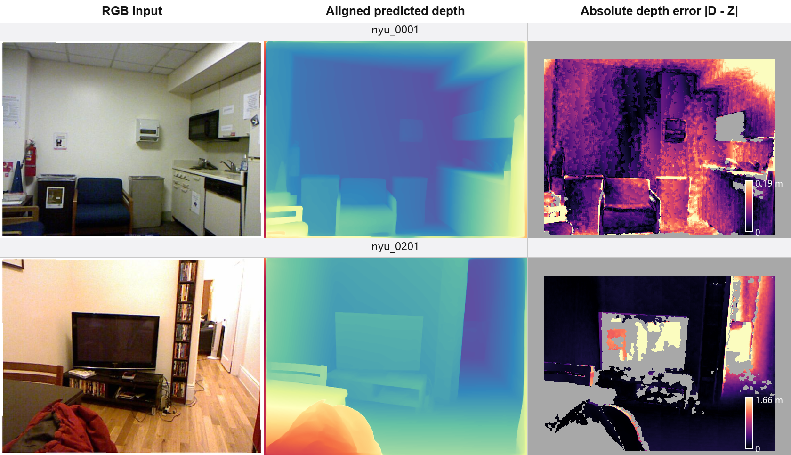
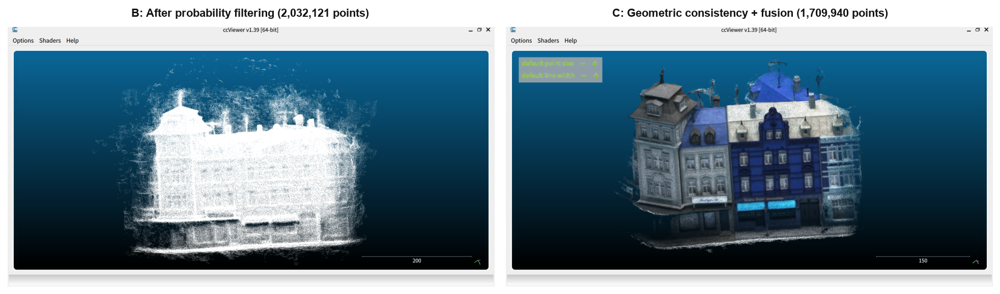
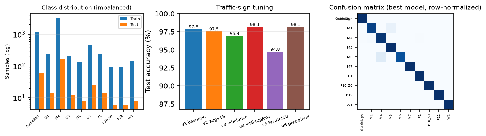

# Machine Vision Labs

A compact collection of three machine-vision course experiments: monocular depth estimation and point-cloud reconstruction, multi-view stereo (MVS) 3D reconstruction, and CNN-based image classification. Each lab folder keeps its report, source code, key result tables/figures, and reproduction notes.

**English** | [简体中文](README.zh-CN.md)

<p align="center">
  
  
  
</p>

## Experiments at a glance

| Lab | Topic | Core method | Headline result | Report |
| --- | --- | --- | --- | --- |
| [Lab 1](lab1) | Monocular depth & point cloud | Depth Anything V2 ViT-S; affine-inverse-depth alignment; back-projection | AbsRel **0.0755**, Depth RMSE **0.374 m**, XYZ RMSE **0.399 m** on 8 NYU images | [PDF](lab1/lab1.pdf) |
| [Lab 2](lab2) | Stereo matching & 3D reconstruction | MVSNet (BlendedMVS weights) + fusibile on DTU scan9 (49 views) | **3.05 M → 2.03 M → 1.71 M** points after probability filtering and geometric fusion | [PDF](lab2/lab2.pdf) |
| [Lab 4](lab4) | CNN image classification | ResNet-10/18/50, optimizer/LR studies, knowledge distillation, traffic-sign tuning | CIFAR-100 **73.46 %** (ResNet-18 + KD-soft); traffic signs **98.15 %** | [PDF](lab4/cv_homework2/报告LaTeX版/lab4.pdf) |

## Lab 1 — Monocular depth estimation and point-cloud reconstruction

- **Model:** Depth Anything V2 ViT-S (24.8 M parameters), both the relative-depth and the metric-depth (Hypersim) checkpoints.
- **Data:** 8 indoor RGB images from NYU Depth V2 with Kinect ground-truth depth, camera intrinsics, and valid masks.
- **Pipeline:** predict affine-invariant inverse depth → least-squares affine alignment to metric depth → back-project with the camera matrix → evaluate AbsRel, depth RMSE, and XYZ RMSE on the valid mask.
- **Findings:**
  - Relative-depth version after alignment: AbsRel 0.0755, depth RMSE 0.374 m, XYZ RMSE 0.399 m.
  - Reducing input size from 518 to 280 is **2.41× faster**, but costs 6–8 % mean accuracy and about 10 % of depth-gradient detail; per-image wins are mixed.
  - The metric version without fitting is 2–3× worse, but a single per-image scale brings its RMSE back to the relative version's level. On NYU it systematically overestimates distance by about **16 %**, and the scale varies per image, so “calibration-free” does not hold across domains.

Contents: `lab1/nyu_data/` (8 RGB images, reference depth, metadata), `lab1/output/` (analysis notes), `lab1/report/` (report builders and figures), `lab1/results/` (CSV metrics, depth visualisations, point-cloud comparison).

> The depth inference itself was run in the course GPU environment; this repository keeps the data, outputs, metrics, figures, and the report-generation scripts. The report builders under `lab1/report/` depend on the Windows/WorkBuddy document SDK used at the time and are kept for provenance rather than as a portable one-click pipeline.

## Lab 2 — Stereo matching and 3D reconstruction

- **Method:** MVSNet with BlendedMVS pretrained weights, followed by the original `fusibile` probability filter and geometric consistency fusion.
- **Data:** DTU scan9, 49 calibrated views; depth maps are produced at 288×216.
- **Pipeline:** `test.py` depth estimation (GPU) → `depthfusion.py` → `fusibile` (GPU) → fused point cloud; then visualisation and report generation (CPU).
- **Findings:**
  - Probability filtering removes about 33 % of low-confidence pixels: **3,048,000 → 2,032,121** valid points.
  - Geometric consistency and fusion reduce this to **1,709,940** points (−15.9 %).
  - The bounding box shrinks from **482 × 517 × 456 mm** to **293 × 401 × 377 mm**; the outlier ratio drops from **11.2 % to 7.9 %**, and point-spacing std from **46.1 to 42.9 mm**.
  - Sweeping `num_consistent` from 2 to 5 monotonically reduces the fused cloud from **1,773,805 to 1,574,962** points, trading completeness for reliability.
  - `interval_scale = 1.06` covers the scene depth range with 128 hypotheses; 0.8 clamps distant regions, while 1.3 over-quantises depth.

Contents: `lab2/MVSNet/` (upstream source), `lab2/fusibile/` (upstream fusion source and scripts), `lab2/exp2_*.py` (fusion, metrics, figures, report), `lab2/report_figures/`, `lab2/result_param_sweep/sweep_log.csv`, and the reports. See [lab2/README.md](lab2/README.md) and [lab2/运行说明.md](lab2/运行说明.md) for the full Chinese walkthrough.

## Lab 4 — CNN image classification

- **Datasets:** CIFAR-100 (100 classes) and a 10-class traffic-sign dataset (6,024 train / 324 test images) with a custom `Dataset`/`DataLoader`. The course traffic-sign images are included under `lab4/cv_homework2/data/Traffic_sign/`.
- **Experiments:** baseline reproduction, SGD/Adam/AdamW/RMSprop, learning-rate and schedule comparison, ResNet-10/18/50 depth study, knowledge distillation (soft targets and logits), and a six-stage traffic-sign tuning ladder (augmentation, label smoothing, balanced sampling, Mixup, cosine schedule, ImageNet pretraining).
- **Findings:**
  - CIFAR-100: ResNet-10 baseline **71.38 %**; ResNet-18 **72.73 %**; ResNet-50 **70.16 %**; best overall **73.46 %** with ResNet-18 + KD-soft (T=4, α=0.7).
  - Traffic signs: v1 **97.84 %**, v4 (Mixup + cosine, 80 epochs) **98.15 %**, v6 (ImageNet pretraining, 40 epochs) **98.15 %** in only **2.0 min**.
  - All experiments use `seed=42`; per-epoch CSV/JSON summaries are included.

Contents: `lab4/cv_homework2/` with training/evaluation code, configs, reports (LaTeX/Word/HTML), `results/` CSVs, logs and figures. See [lab4/cv_homework2/README.md](lab4/cv_homework2/README.md).

## Repository layout

```text
machine-vision-labs/
├── README.md                  # English (this file)
├── README.zh-CN.md            # 简体中文
├── lab1/                      # Monocular depth & point cloud
│   ├── nyu_data/              # 8 RGB images + reference depth + metadata
│   ├── output/                # Analysis notes
│   ├── report/                # Report builders, parts, figures
│   └── results/               # Metrics CSV, depth PNGs, point-cloud comparison
├── lab2/                      # MVSNet / DTU scan9
│   ├── MVSNet/                # Upstream MVSNet source
│   ├── fusibile/              # Upstream fusibile source
│   ├── report_figures/        # Report figures
│   ├── result_param_sweep/    # num_consistent sweep results
│   └── exp2_*.py              # Fusion, metrics, figures, report
└── lab4/                      # CNN image classification
    └── cv_homework2/
        ├── train.py           # Unified training framework
        ├── run_all.py         # Experiment matrix runner
        ├── data/Traffic_sign/ # Included course traffic-sign dataset
        ├── results/           # CSV/JSON/logs/figures
        ├── report/            # HTML report
        ├── 报告LaTeX版/        # LaTeX source + PDF
        └── 报告Word版/         # Word generator + DOCX
```

## What is not tracked

To keep the repository lightweight (about 72 MB) and within GitHub limits, the following large artifacts are intentionally excluded. The course-provided traffic-sign dataset **is included**; the code and READMEs explain where to place the remaining artifacts.

| Excluded artifact | Why | Where to get it |
| --- | --- | --- |
| `lab2/dtu_test_scan9/` | DTU images, depth maps, and PLY point clouds are multi-GB | [DTU MVS dataset](https://roboimagedata.compute.dtu.dk/?page_id=36), scan9 |
| `lab2/tf_model_blendedmvs_200301/` | TensorFlow checkpoint (~120 MB) | [MVSNet repository](https://github.com/YoYo000/MVSNet) (BlendedMVS pretrained model) |
| `lab2/result_param_sweep/*.ply` | 4 × ~25 MB fused clouds; only `sweep_log.csv` is needed for the report | Re-run `fusibile/run_param_sweep.sh` |
| `lab4/cv_homework2/data/cifar-100-python/` | CIFAR-100 (~178 MB) | Downloads automatically via `torchvision` |
| `lab4/cv_homework2/results/*.pth` | Model weights (up to ~190 MB each) | Re-train with `run_all.py` |
| `lab1/results/**/*.npy`, `*.ply` | Per-image depth arrays and point clouds (~325 MB) | Re-run the depth pipeline; PNG previews are kept |

## Quick start

```bash
git clone <this-repository-url>
cd machine-vision-labs
```

Each lab is self-contained:

- **Lab 1:** Python 3.12 + PyTorch 2.7.1 (CUDA 12.8), Open3D 0.19. The 8-image dataset and reference depth are included; download the Depth Anything V2 weights separately. See `lab1/output/` for the analysis and `lab1/lab1.pdf` for the report.
- **Lab 2:** Python 3.8 + NVIDIA TensorFlow 1.15.5 + CUDA 12.4 for `fusibile`. Put DTU scan9 under `lab2/dtu_test_scan9/scan9/` and the checkpoint under `lab2/tf_model_blendedmvs_200301/`, then follow `lab2/运行说明.md`. GPU is required for depth estimation and fusion.
- **Lab 4:** Python 3.12 + PyTorch 2.11 (CUDA 12.8). Install `requirements.txt`. The traffic-sign data is already included; CIFAR-100 downloads automatically on first run. Then run `bash smoke_test.sh` and `bash run_pipeline.sh`.

## Reports

| Lab | PDF | DOCX | Other |
| --- | --- | --- | --- |
| Lab 1 | [lab1.pdf](lab1/lab1.pdf) | [lab1.docx](lab1/lab1.docx) | [Assignment](lab1/实验课1-单目深度与点云重建.pdf) |
| Lab 2 | [lab2.pdf](lab2/lab2.pdf) | [lab2.docx](lab2/lab2.docx) | [Assignment](lab2/实验课2-立体匹配与三维重建.pptx) |
| Lab 4 | [lab4.pdf](lab4/cv_homework2/报告LaTeX版/lab4.pdf) | [实验报告-图像分类2.docx](lab4/cv_homework2/报告Word版/实验报告-图像分类2.docx) | [HTML](lab4/cv_homework2/report/report.html), [Assignment](lab4/图像分类实验2.pdf) |

## Environment summary

| Lab | OS / Python | Framework | GPU |
| --- | --- | --- | --- |
| Lab 1 | Windows, Python 3.12 | PyTorch 2.7.1, CUDA 12.8 | RTX 4060 Laptop 8 GB |
| Lab 2 | Ubuntu 24.04, Python 3.8 | NVIDIA TensorFlow 1.15.5, CUDA 12.4 | RTX 4070 Laptop 8 GB |
| Lab 4 | Ubuntu, Python 3.12.3 | PyTorch 2.11.0+cu128 | RTX 4070 Laptop 8 GB |

## Acknowledgements

This work builds on [Depth Anything V2](https://github.com/DepthAnything/Depth-Anything-V2), [MVSNet](https://github.com/YoYo000/MVSNet), [fusibile](https://github.com/kyle-sf999/fusibile), the [DTU MVS dataset](https://roboimagedata.compute.dtu.dk/?page_id=36), [CIFAR-100](https://www.cs.toronto.edu/~kriz/cifar.html), and the course materials. Upstream code and licenses are kept in their respective folders.

## Notes

- Reports and analysis are in Chinese; this README provides the English overview.
- Personal identifiers in the reports and document metadata have been removed.
- The folder `lab4` follows the course schedule; its report is titled “图像分类实验2” (Image Classification Lab 2).
- Code is shared for learning and reproducibility. Report text and course materials remain the authors' and the course instructor's work.
