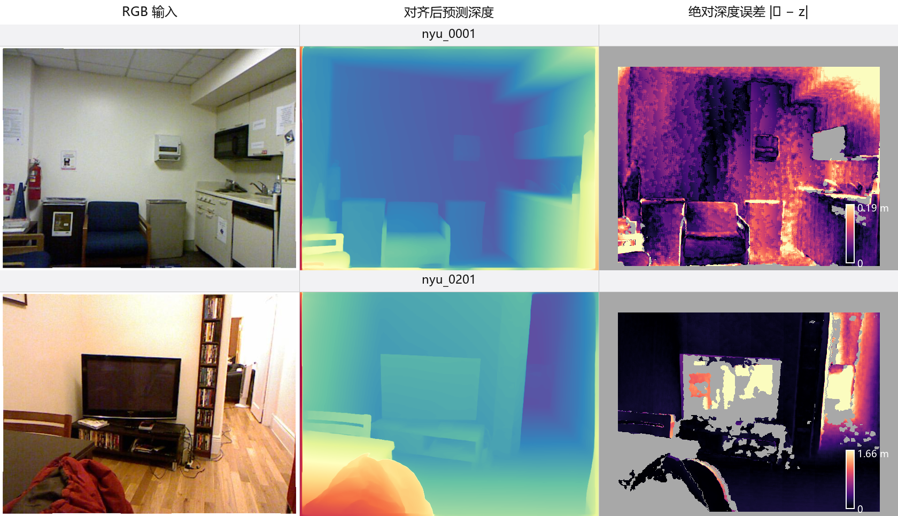
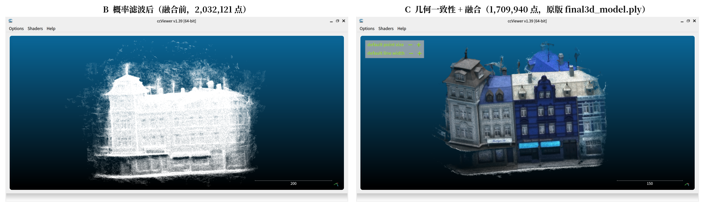
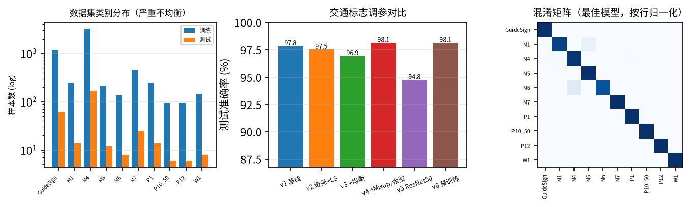

# 机器视觉实验合集

本仓库汇总了机器视觉课程的三次实验：单目深度估计与点云重建、多视图立体匹配（MVS）三维重建、基于卷积网络的图像分类。每个实验目录都保留了实验报告、源代码、关键结果表/图以及复现说明。

[English](README.md) | **简体中文**

<p align="center">
  
  
  
</p>

## 实验总览

| 实验 | 主题 | 核心方法 | 主要结果 | 报告 |
| --- | --- | --- | --- | --- |
| [实验一](lab1) | 单目深度与点云重建 | Depth Anything V2 ViT-S；仿射逆深度对齐；反投影 | 8 张 NYU 图像上 AbsRel **0.0755**、Depth RMSE **0.374 m**、XYZ RMSE **0.399 m** | [PDF](lab1/lab1.pdf) |
| [实验二](lab2) | 立体匹配与三维重建 | MVSNet（BlendedMVS 权重）+ fusibile，DTU scan9（49 视角） | 概率滤波与几何融合后点数 **304.8 万 → 203.2 万 → 171.0 万** | [PDF](lab2/lab2.pdf) |
| [实验四](lab4) | 卷积网络图像分类 | ResNet-10/18/50、优化器/学习率实验、知识蒸馏、交通标志调参 | CIFAR-100 最高 **73.46 %**（ResNet-18 + KD-soft）；交通标志 **98.15 %** | [PDF](lab4/cv_homework2/报告LaTeX版/lab4.pdf) |

## 实验一：单目深度估计与点云重建

- **模型：** Depth Anything V2 ViT-S（24.8 M 参数），同时使用相对深度版和 Metric Depth（Hypersim）版。
- **数据：** NYU Depth V2 的 8 张室内 RGB 图像，附 Kinect 真值深度、相机内参与有效像素掩码。
- **流程：** 预测仿射不变的逆深度 → 最小二乘仿射对齐到米制深度 → 用内参反投影为点云 → 在有效掩码内计算 AbsRel、Depth RMSE、XYZ RMSE。
- **结论：**
  - 相对深度版对齐后：AbsRel 0.0755、Depth RMSE 0.374 m、XYZ RMSE 0.399 m。
  - 输入分辨率从 518 降到 280 可提速 **2.41 倍**，代价是均值精度劣化 6%~8%、深度梯度细节减少约 10%；逐图胜负混合。
  - Metric 版零拟合时精度差 2~3 倍；补一个逐图尺度后，RMSE 与相对版几乎持平。它在 NYU 上系统性高估距离约 **16 %**，且尺度逐图波动，跨域时“免标定”并不成立。

目录内容：`lab1/nyu_data/`（8 张 RGB、参考深度、元数据）、`lab1/output/`（分析笔记）、`lab1/report/`（报告生成脚本与插图）、`lab1/results/`（指标 CSV、深度可视化、点云对比）。

> 深度推理本身在课程 GPU 环境中完成；本仓库保留数据、输出、指标、插图和报告生成脚本。`lab1/report/` 下的报告脚本依赖当时使用的 Windows/WorkBuddy 文档 SDK，主要用于留档，并非可移植的一键流程。

## 实验二：立体匹配与三维重建

- **方法：** MVSNet + BlendedMVS 预训练权重，随后用原版 `fusibile` 做概率滤波和几何一致性融合。
- **数据：** DTU scan9，49 个标定视角；深度图分辨率 288×216。
- **流程：** `test.py` 深度估计（GPU）→ `depthfusion.py` → `fusibile`（GPU）→ 融合点云；之后做可视化与报告生成（CPU）。
- **结论：**
  - 概率滤波剔除约 33% 低置信度像素：**3,048,000 → 2,032,121** 个有效点。
  - 几何一致性与融合后降至 **1,709,940** 点（−15.9%）。
  - 包围盒由 **482 × 517 × 456 mm** 收缩为 **293 × 401 × 377 mm**；离群点比例由 **11.2% 降至 7.9%**，点距标准差由 **46.1 降至 42.9 mm**。
  - `num_consistent` 从 2 扫到 5，融合点数从 **1,773,805** 单调降至 **1,574,962**，体现“完整性 ↔ 可靠性”的权衡。
  - `interval_scale = 1.06` 时 128 个深度假设恰好覆盖场景深度范围；0.8 会使远区被钳位，1.3 会造成远景块状量化。

目录内容：`lab2/MVSNet/`（上游源码）、`lab2/fusibile/`（上游融合源码与脚本）、`lab2/exp2_*.py`（融合、指标、绘图、报告）、`lab2/report_figures/`、`lab2/result_param_sweep/sweep_log.csv` 以及报告。完整中文步骤见 [lab2/README.md](lab2/README.md) 与 [lab2/运行说明.md](lab2/运行说明.md)。

## 实验四：卷积网络图像分类

- **数据集：** CIFAR-100（100 类）与 10 类交通标志数据集（训练 6,024 张 / 测试 324 张），使用自写 `Dataset`/`DataLoader`。课程提供的交通标志图像已包含在 `lab4/cv_homework2/data/Traffic_sign/`。
- **实验内容：** 基线复现、SGD/Adam/AdamW/RMSprop 对比、学习率与调度器对比、ResNet-10/18/50 深度对比、知识蒸馏（soft targets 与 logits），以及交通标志的六阶段调参（增强、标签平滑、类别均衡采样、Mixup、余弦调度、ImageNet 预训练）。
- **结论：**
  - CIFAR-100：ResNet-10 基线 **71.38%**；ResNet-18 **72.73%**；ResNet-50 **70.16%**；最佳为 ResNet-18 + KD-soft（T=4、α=0.7）的 **73.46%**。
  - 交通标志：v1 **97.84%**；v4（Mixup + 余弦，80 epoch）**98.15%**；v6（ImageNet 预训练，40 epoch）**98.15%**，仅耗时 **2.0 分钟**。
  - 所有实验固定 `seed=42`，仓库保留逐 epoch CSV 与 JSON 汇总。

目录内容：`lab4/cv_homework2/`，含训练/评估代码、配置、LaTeX/Word/HTML 报告、`results/` 下的 CSV、日志与图表。详见 [lab4/cv_homework2/README.md](lab4/cv_homework2/README.md)。

## 仓库结构

```text
machine-vision-labs/
├── README.md                  # English
├── README.zh-CN.md            # 简体中文（本文件）
├── lab1/                      # 单目深度与点云
│   ├── nyu_data/              # 8 张 RGB + 参考深度 + 元数据
│   ├── output/                # 分析笔记
│   ├── report/                # 报告脚本、正文片段、插图
│   └── results/               # 指标 CSV、深度 PNG、点云对比
├── lab2/                      # MVSNet / DTU scan9
│   ├── MVSNet/                # 上游 MVSNet 源码
│   ├── fusibile/              # 上游 fusibile 源码
│   ├── report_figures/        # 报告插图
│   ├── result_param_sweep/    # num_consistent 扫描结果
│   └── exp2_*.py              # 融合、指标、绘图、报告
└── lab4/                      # 卷积网络图像分类
    └── cv_homework2/
        ├── train.py           # 统一训练框架
        ├── run_all.py         # 实验矩阵调度
        ├── data/Traffic_sign/ # 已包含的课程交通标志数据
        ├── results/           # CSV/JSON/日志/图表
        ├── report/            # HTML 报告
        ├── 报告LaTeX版/        # LaTeX 源码 + PDF
        └── 报告Word版/         # Word 生成脚本 + DOCX
```

## 未纳入仓库的大文件

为控制仓库体积（约 72 MB）并符合 GitHub 限制，以下大文件未提交；课程提供的交通标志数据**已包含**，其余内容的放置位置见下表与代码说明。

| 未纳入内容 | 原因 | 获取方式 |
| --- | --- | --- |
| `lab2/dtu_test_scan9/` | DTU 图像、深度图与 PLY 点云达数 GB | [DTU MVS 数据集](https://roboimagedata.compute.dtu.dk/?page_id=36)，scan9 |
| `lab2/tf_model_blendedmvs_200301/` | TensorFlow checkpoint（约 120 MB） | [MVSNet 仓库](https://github.com/YoYo000/MVSNet) 的 BlendedMVS 预训练模型 |
| `lab2/result_param_sweep/*.ply` | 4 个约 25 MB 的融合点云；报告只需要 `sweep_log.csv` | 重跑 `fusibile/run_param_sweep.sh` |
| `lab4/cv_homework2/data/cifar-100-python/` | CIFAR-100（约 178 MB） | 由 `torchvision` 自动下载 |
| `lab4/cv_homework2/results/*.pth` | 模型权重（单个最大约 190 MB） | 用 `run_all.py` 重新训练 |
| `lab1/results/**/*.npy`、`*.ply` | 逐图深度数组与点云（约 325 MB） | 重跑深度流程；仓库保留 PNG 预览 |

## 快速开始

```bash
git clone <this-repository-url>
cd machine-vision-labs
```

每个实验目录相对独立：

- **实验一：** Python 3.12 + PyTorch 2.7.1（CUDA 12.8）、Open3D 0.19。8 张图像与参考深度已包含；Depth Anything V2 权重需另行下载。分析见 `lab1/output/`，报告见 `lab1/lab1.pdf`。
- **实验二：** Python 3.8 + NVIDIA TensorFlow 1.15.5 + CUDA 12.4（用于 `fusibile`）。将 DTU scan9 放到 `lab2/dtu_test_scan9/scan9/`，checkpoint 放到 `lab2/tf_model_blendedmvs_200301/`，然后按 `lab2/运行说明.md` 操作。深度估计与融合需要 GPU。
- **实验四：** Python 3.12 + PyTorch 2.11（CUDA 12.8）。安装 `requirements.txt`；交通标志数据已包含，CIFAR-100 首次运行会自动下载。然后运行 `bash smoke_test.sh` 与 `bash run_pipeline.sh`。

## 报告

| 实验 | PDF | DOCX | 其他 |
| --- | --- | --- | --- |
| 实验一 | [lab1.pdf](lab1/lab1.pdf) | [lab1.docx](lab1/lab1.docx) | [任务书](lab1/实验课1-单目深度与点云重建.pdf) |
| 实验二 | [lab2.pdf](lab2/lab2.pdf) | [lab2.docx](lab2/lab2.docx) | [任务书](lab2/实验课2-立体匹配与三维重建.pptx) |
| 实验四 | [lab4.pdf](lab4/cv_homework2/报告LaTeX版/lab4.pdf) | [实验报告-图像分类2.docx](lab4/cv_homework2/报告Word版/实验报告-图像分类2.docx) | [HTML](lab4/cv_homework2/report/report.html)、[任务书](lab4/图像分类实验2.pdf) |

## 环境汇总

| 实验 | 系统 / Python | 框架 | GPU |
| --- | --- | --- | --- |
| 实验一 | Windows，Python 3.12 | PyTorch 2.7.1，CUDA 12.8 | RTX 4060 Laptop 8 GB |
| 实验二 | Ubuntu 24.04，Python 3.8 | NVIDIA TensorFlow 1.15.5，CUDA 12.4 | RTX 4070 Laptop 8 GB |
| 实验四 | Ubuntu，Python 3.12.3 | PyTorch 2.11.0+cu128 | RTX 4070 Laptop 8 GB |

## 致谢

本工作基于 [Depth Anything V2](https://github.com/DepthAnything/Depth-Anything-V2)、[MVSNet](https://github.com/YoYo000/MVSNet)、[fusibile](https://github.com/kyle-sf999/fusibile)、[DTU MVS 数据集](https://roboimagedata.compute.dtu.dk/?page_id=36)、[CIFAR-100](https://www.cs.toronto.edu/~kriz/cifar.html) 以及课程材料。上游代码及其许可证保留在对应目录中。

## 说明

- 实验报告与分析正文为中文；英文概述见 [README.md](README.md)。
- 报告正文与文档元数据中的个人身份信息已移除。
- `lab4` 目录编号沿用课程安排，其报告标题为“图像分类实验2”。
- 代码用于学习与复现；报告正文与课程材料版权归作者及课程教师所有。
